<div align="center">
  
  <h1>Ombre</h1>
  <p>Ombre Browser: a native macOS browser on WebKit, with an Arc-like experience.</p>
</div>

<p align="center">
  <a href="https://www.apple.com/macos/"></a>
  <a href="https://swift.org"></a>
  <a href="LICENSE"></a>
</p>

> [!NOTE]
> Ombre is in active development and not ready for daily use yet.

## Overview

Ombre is a macOS browser built with SwiftUI, AppKit and WebKit: the experience of Arc, with the engine, energy use and
privacy of Safari.

- Spaces, pinned and favorite tabs, folders, Split View and Peek
- Content blocking and privacy protections per space, private windows that leave nothing on disk
- Safari and Chrome Web Store extensions (macOS 15.4+)
- Notes, tasks, and time and focus tracking per space
- Import from Zen

## Development

```bash
git clone https://github.com/barto95100/ora-browser.git
cd ora-browser
./scripts/setup.sh
open Ombre.xcodeproj
```

- The Xcode project is generated by [XcodeGen](https://github.com/yonaskolb/XcodeGen) from `project.yml`: run
  `xcodegen` after adding or removing files.
- Tests (Swift Testing): `xcodebuild test -scheme Ombre -destination 'platform=macOS,arch=arm64'`
- Git hooks ([lefthook](https://github.com/evilmartians/lefthook)) run SwiftFormat and SwiftLint before each commit.
- Release build: `./scripts/build.sh` builds a signed `Ombre.app` and `build/Ombre-<version>.dmg`.

## License

Ombre is licensed under the [GNU General Public License v3.0](LICENSE).

Ombre is derived from [Ora Browser](https://github.com/the-ora/browser) (the-ora/browser), licensed under GPL-3.0.

Third-party components keep their own licenses: see [THIRD_PARTY_NOTICES.md](THIRD_PARTY_NOTICES.md).
